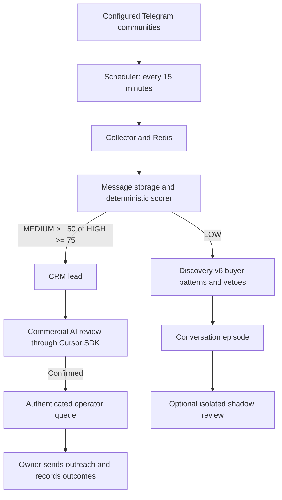

# Telegram Lead Monitor — readiness and next steps

Assessment date: **5 November 2026, Moscow time**. Checkout: `4852a2050d36c2c007db3677af5fcd1f842fd013`, committed 1 October. Scope: analysis only; no application, configuration, database, collector cursor, or deployment changes.

**Recommendation: prioritize reliable capture, a consistent commercial definition, verified buyer sources, and prompt delivery to the owner.** The project has useful scoring, commercial AI, context retrieval, and CRM components. It has not demonstrated a dependable flow of fresh sales opportunities. More historical messages or a trained ML model would not, by themselves, complete that flow.

The working business assumption is paid trading-bot, trading-system, quant, and ML engineering projects, including relevant contract work. Full-time employment and broader non-trading software work need an explicit product decision. The owner was asked about this scope and the production connection during this investigation; neither answer had arrived when this report was prepared.

**What is verified now, and what is historical**

On the supplied Ubuntu host, `1831dan`, the default Docker daemon has no Telegram Lead Monitor containers, Compose project, or named volumes. It shows only an unrelated `qts-postgres` container and `qts_pgdata` volume. The configured application endpoints `/health`, `/validation/gates`, and `/metrics` at `127.0.0.1:8010` all refuse connection: curl exit 7, HTTP 000. The local configuration still points to Compose hostnames `postgres` and `redis`.

This establishes that the documented stack is unavailable through this host's configured Docker environment. It does **not** establish that production data was deleted or that another host is down. No substitute database was created, and the unrelated database was not inspected. Today's message volume, backlog, confirmed leads, outcomes, and validation gates remain unverified. Finding the actual production database/session volumes is the first operational dependency.

Historical evidence, with dates kept separate:

| Evidence date | Recorded result | Interpretation |
|---|---|---|
| 23 Sep | 4 AI-confirmed opportunities from a historical/provisional backfill; 0 contacted, responded, or won | Commercial AI worked on a small selected cohort. This was not four newly captured hot leads or a conversion result. |
| 25 Sep | 116,919 messages in the preceding 7 days, all scored; 1 HIGH and 0 MEDIUM | Very low yield in that historical traffic. It does not measure recall or prove that all rejected messages were irrelevant. |
| 29 Sep | 8,711,501 stored messages; 215,070 score rows, about 2.47% | A large archive with sparse persisted scoring overall. Recent coverage and historical coverage differ substantially. |
| 29 Sep | 1,524 rows in `human_labels`; 389 `TRUE_LEAD`, but only 6 marked commercially actionable and 1,380 with that field unset | Legacy/provisional labels are not a dependable commercial training target or independent validation. |
| 29 Sep | Offline replay: all 1,600 sampled texts scored LOW; 1,317 came from exchange-official communities | That sample was dominated by exchange traffic. Its result is not a corpus-wide prevalence estimate. |
| 1 Oct | 2,600-message core review frame; latest semantics audit recorded only 2 reviewed messages, both false | There is insufficient completed human review to conclude that the archive contains no demand. |

Sources: [commercial pilot](evidence/90-commercial-ai-live-sdk-pilot-20260923.txt), [25 Sep coverage](evidence/96-commercial-discovery-root-cause-360d.txt), [29 Sep inventory](evidence/130-offline-ml-dataset-readiness-inventory.json), [offline replay](evidence/130-offline-ml-replay-disc-v6.txt), [1 Oct semantics review](evidence/138-commercial-semantics-review.txt). The September discovery-v4 findings are historical; the current checkout uses discovery v6.

**How the current logic works**

The scorer combines domain terms, commercial-action expressions, budget and urgency evidence, community priors, and exclusions. AI reviews happen **after** the scorer has admitted a MEDIUM/HIGH lead. Consequently, adding a stronger AI reviewer cannot recover a message rejected before this stage.

Commercial AI uses A/B/C opinions, requires at least two confirming opinions for confirmation, and rejects when a hard veto is present. This commercial path is separate from independent validation and does not need the ML gate to open. Its current production review is message-based; the conversation-context implementation sits in the isolated discovery/shadow path.

LOW discovery may build useful episodes, but it deliberately cannot create production CRM leads or outreach events. Local configuration has discovery enabled and episode shadow disabled; these are configuration observations, not proof of running workers. `/review/` serves a blind research sample. The sales queue is `/ops/queue`; the repository has no corresponding sales UI or owner-alert service.

**Problems that prevent reliable lead capture**

| Priority | Finding and evidence | Business consequence |
|---|---|---|
| P0 | Documented runtime unavailable on this host | No current collection or lead-delivery claim can be verified. |
| P0 | Collector fetches at most 200 messages newest-first, then advances its cursor to the newest ID | A burst or recovery backlog can leave unseen messages permanently behind the normal incremental cursor. |
| P1 | Workers read Redis with `>` only; no pending-message recovery is implemented | Failed work can remain pending indefinitely despite comments saying it will retry. |
| P1 | Commercial review rate-limit returns normally, and the worker then acknowledges the event | A capped candidate is discarded from the review stream rather than deferred. This is a code-path risk, not an observed current production loss count. |
| P1 | Analyzer commits before publishing commercial work; publication failures are logged and processing returns | There is no durable guarantee that every persisted eligible lead gets an AI review. |
| P1 | Explicit buyer requests can miss the regex gate; some recovered LOW requests stop at the experimental episode boundary | Real-looking paid requests never reach the operator queue. |
| P1 | No age limit in `/ops/queue`; it orders by status, raw score, then date | An old confirmed lead can outrank a fresh opportunity. Stored AI `rank_score` is not used by this queue. |
| P1 | No owner notifications; the only implemented web UI is blind review | Finding an opportunity still depends on someone manually polling the API. |
| P2 | Commercial deduplication is normalized text plus community | Cross-posts and paraphrases can appear as distinct opportunities. |

The collector defect was reproduced without Telegram or database calls using the actual collector methods and a fake history iterator matching Telethon's documented behavior. With cursor 100 and 500 new messages, the first scan publishes 200 and moves the cursor to 600; the next scan publishes zero. IDs 101–400, **300 messages**, were skipped. This proves the failure condition; it does not measure how much historical production data was lost. [Telethon documents descending order and a total retrieval limit](https://docs.telethon.dev/en/stable/modules/client.html#telethon.client.messages.MessageMethods.iter_messages).

Redis `>` consumption excludes previously delivered pending entries unless recovery is explicitly requested. Add pending-work reclamation, bounded retries, and durable failed-work handling. [Redis XREADGROUP](https://redis.io/docs/latest/commands/xreadgroup/) and [XAUTOCLAIM](https://redis.io/docs/latest/commands/xautoclaim/) describe the relevant behavior.

The standard `/health` endpoint checks PostgreSQL and Redis connectivity only. Even a successful response would not prove fresh collection, scoring, AI review, or alert delivery.

**Concrete scoring behavior reproduced in this checkout**

These are synthetic diagnostic examples, scored with the general community profile. They are not discovered customer messages, a representative evaluation set, or measured precision/recall.

| Message | Scorer | Discovery | Effect |
|---|---|---|---|
| “Looking for a developer to build a trading bot for Binance. Budget $3000.” | HIGH, 100 | Eligible | Normal commercial AI route available. |
| “Can someone build a trading bot for me? Budget $3000, paid project.” | LOW, 30 | Ineligible | Paid buyer wording missed entirely. |
| “Who can build me a Binance trading bot? Paid work, budget $3000.” | LOW, 30 | Eligible | Recovered only into discovery, with no production CRM route. |
| “Ищу разработчика для торгового бота Binance, бюджет 100000 рублей.” | LOW, 30 | Eligible | Russian buyer request also depends on the disconnected discovery path. |
| “Кто может написать торгового бота для Binance? Бюджет 100000 рублей.” | LOW, 30 | Ineligible | Another paid buyer wording missed entirely. |
| “I can build a trading bot for you. DM me. Budget $500.” | LOW, 10 | Ineligible | Vendor exclusion works on this example. |
| “I need someone to teach us trading, please.” | LOW, 0 | Eligible | Discovery still admits education requests outside the engineering objective. |

Template dependence is another concern. “Freelance Opportunity: Quick Fix Needed for Python Trading Bot. Budget: $320” scores HIGH and is discoverable; the equivalent synthetic “NEW PROJECT ON LABORX” title scores LOW and is vetoed. The latter veto is intentional in the existing design, rather than an accidental implementation deviation. Its business usefulness should be reconsidered against actual engineering deliverables, not indiscriminately removed.

There is a scope conflict to resolve: the README and commercial pilot include paid contract projects, the four historical confirmations were marketplace opportunities, while some later audits broadly treat marketplace/gig listings as contamination. A marketplace post can be a paid project, employment, an unrelated gig, or advertising. Evaluate the requested deliverable and buyer evidence, and retain source type as a separate attribute. Product-lead/CTO employment does not automatically become a trading-engineering lead because it includes a budget.

**Recommended next work, in execution order**

1. **Locate and verify production, then repair capture reliability.** Identify the real Compose deployment, PostgreSQL data, Redis persistence, and Telegram session. Record current message/score freshness, scan completion, queue lag and oldest pending age, lead statuses, and actual outcomes. Repair bounded history pagination and cursor progression; add Redis recovery, durable review dispatch, and rate-limit deferral. Validate bursts, crashes, timeouts, and restarts with isolated fixtures. Do not reset live cursors to recover history: use a separate bounded reconciliation process once gaps are established. Completion means no skipped messages in the 500-message reproduction and eventual review of eligible work after injected failures.

2. **Define a hot lead with examples the owner would actually pursue.** Use: an in-scope paid deliverable or clear commissioning/hiring intent, a recent request, and an actionable contact/application route. Record budget, deadline, service fit, and confidence separately; absence of a published budget alone should not prove absence of a buyer. Establish minimum worthwhile project economics with the owner. Suggested initial freshness buckets: hot under 24 hours, recent 1–7 days, historical research beyond that. These are proposed operating rules, not existing behavior. Label a small shared set covering direct requests, marketplace projects, jobs, support, vendors, and ambiguous cases; keep these non-independent business examples out of independent validation numerators.

3. **Improve relevant supply and retrieval together.** Review 5–10 verified, accessible communities at a time. Confirm entity ID, group/channel type, language, recent activity, actual buyer requests, and a response route before adding a source. Earlier sourcing work found invalid usernames, wrong entities, and effectively empty rooms; do not repeat username-only expansion. Keep dated records of source yield. Search recent raw `messages`, including unscored messages, with a bounded multilingual buyer-intent retrieval pass. Fix demonstrated English/Russian omissions without reducing 75/50 thresholds or weakening vendor/support protections. Use older data to build evaluation examples and discover promising sources, not as a fresh-lead queue.

4. **Create a measured route from discovered buyer requests to commercial review.** First test candidate retrieval plus author/reply context on real, non-blind examples. Require evidence attributable to the buyer, not surrounding sellers. Separate possible demand from final qualification. Compare accepted and rejected candidates, preserve hard negatives, and log the reason for every exclusion. Once demonstrated, implement a controlled production path to commercial AI and CRM with provenance and deduplication. Merely enabling the current shadow worker will not do this; it is intentionally isolated. Commercial progress should not wait for unrelated supervised-ML readiness, and commercial decisions must never count as independent validation.

5. **Deliver an actionable owner inbox.** Provide a sales UI and owner-directed notifications with the original quote, source/message link, request age, requested work, budget/deadline if stated, response route, evidence, and an editable outreach draft. Rank by freshness, service fit, buying evidence, and contactability. Separate stale leads and cross-post duplicates. Support dismiss, contact, follow-up, response, proposal, won, and lost with actual evidence. Keep external prospect outreach manual. Proposed latency target: p95 under five minutes for priority sources, which requires a faster or event-driven collection path than the current 15-minute schedule. Measure Telegram publication time through owner delivery, including AI time.

6. **Run a short commercial pilot and decide from outcomes.** Start a seven-day measurement window after runtime verification and the basic delivery path work. Count unique in-scope candidates, owner-accepted leads, false-positive reasons, reachable leads, delivered alerts, response time, conversations, proposals, and wins. Attribute results to source and pipeline stage. A reasonable initial quality target is at least 80% owner acceptance among 20 or more delivered leads; report the actual denominator and uncertainty. If there are fewer leads, report low supply instead of weakening qualification. Review a separate sample of rejected messages to estimate missed demand; accepted-lead precision alone cannot reveal recall. Use a time-separated holdout for changes. Preserve the existing ML gates unchanged.

**What to defer**

Defer broad multi-million-message rescoring, new ML training/Optuna/SHAP work, and uncontrolled source expansion. The archive is useful, but the immediate engineering gaps are already demonstrable without a new model. The historical validation snapshot had 94 validated messages and zero validated positives; today's gates are unavailable. No ML GO is justified by this investigation.

**Validation and limits**

Existing targeted tests: **91 passed in 1.92 seconds**, covering scorer behavior, commercial gates, discovery v4/v5/v6 cases, commercial decision policy, cursor invariants, and opportunity deduplication. The cursor tests do not cover capped newest-first overflow. Fourteen additional in-process diagnostic texts and the isolated collector reproduction are recorded in [current audit evidence](evidence/140-current-state-audit-20261105.json), along with source hashes and runtime check results.

No live SQL queries, SDK/model calls, notifications, or outreach were performed. The review does not establish current lead counts, production loss volume, source prevalence, precision, recall, or revenue. Existing uncommitted workspace files were preserved. Only this report and its evidence JSON were added.
