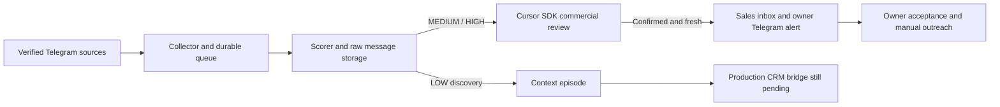

# Telegram Lead Monitor — rebuild status and next steps

**The native foundation and sales workflow are ready for live setup, but the system is not yet proven to find or deliver hot leads.** The fresh production database has no communities, messages, leads, or owner deliveries. Two external prerequisites remain: a new Telegram login and working Cursor SDK account access.

This report follows the [5 November code/data audit](LEAD_READINESS_REPORT_2026-11-05.md). The owner then confirmed deleting the Docker deployment after disk exhaustion and requested a fresh native installation. No historical dump has been substituted for the new production database. Historical counts in the earlier report are not current production counts.

| Area | What changed | Evidence still needed |
|---|---|---|
| Production | Native PostgreSQL 16, Redis, and systemd user services; reboot persistence enabled. API uses loopback port 8010. | Telegram authentication and real collection. |
| Capture | Oldest-first pagination with durable page cursors; pending-event recovery; worker heartbeats; durable dispatch outbox; capacity deferral. | The reproduction now captures 500/500 synthetic messages, but live backlog capture has not been verified. |
| Commercial definition | Explicit paid trading/quant/financial ML deliverables, repairs and contract projects. Marketplace heading alone does not determine eligibility. | Owner assessment of representative recent messages; full-time jobs and broader software remain separate scope decisions. |
| Retrieval | Six demonstrated EN/RU and marketplace requests now reach commercial review. Discovery v7 excludes the teaching-only example. Scorer thresholds stay 75/50. | Live recall audit, especially LOW and unscored raw messages. |
| Commercial AI | Fixed skeptical-vote inversion; positive votes require source quotes and a known buyer action/type; confirmation requires votes from at least two model families. Provider outages defer work. | All configured SDK probes currently fail before model execution with `plan_required`. No successful real adjudication claimed. |
| Inbox and alerts | Fresh, Older, In progress and Duplicates views; request text/source/age/service/budget/deadline/contact/draft; owner Saved Messages; durable, deduplicated notifications. | Actual owner delivery after login and model access. Browser fixtures and transport mocks are not live deliveries. |
| Sales pilot | Counts deliveries, owner acceptance/rejection, replies, proposals and wins by source; posting-to-delivery p95. Feedback does not write independent labels. | Seven actual days, at least 20 delivered leads, owner outcomes, and a rejected-message audit. The pilot has not started. |

The production route is now:

The most consequential logic changes are in [paid request evidence](../../shared/commercial_scope.py), [commercial vote policy](../../shared/commercial_ai/policy.py), [owner notification handling](../../shared/sales.py), and [inbox/outcome metrics](../../services/api/app/sales_routes.py). The [native runbook](../ops/NATIVE_PRODUCTION_RUNBOOK.md) gives exact commands and operational limits.

**Next steps, in order:**

1. **Restore Telegram access.** In the host terminal run `.venv/bin/python scripts/telegram_login.py`. Enter the code and any 2FA password there. Alerts default to the monitoring account's Saved Messages. There are no enabled communities yet, so authentication alone will not begin useful monitoring.
2. **Restore commercial AI access.** The SDK returns `[plan_required] Cloud Agent is not available for free users`. Enable eligible account access or privately update `CURSOR_API_KEY` in `.env.validation`, then run `.venv/bin/python scripts/sdk_preflight.py` and restart `tlm-commercial-ai`. Rotate the credential exposed by the earlier test failure. Do not paste secrets into chat. The preflight must pass for all configured reviewers before calling the AI path ready; it is connectivity evidence, not independent validation or lead-quality evidence.
3. **Verify a small source batch.** Inspect 5–10 communities from the existing candidate list, resolving actual entities and checking recent activity, real buyer requests, language and response routes. Prefer sources with concrete projects over broad exchange/news/job traffic. Do not import the old broad list wholesale. Record candidate examples and rejected examples with links; report limited sampling honestly.
4. **Verify capture and retrieval on real data.** Scan a bounded two-day window, reconcile counts and cursor continuity, and inspect queue age/errors. Search recent raw messages whether HIGH, MEDIUM, LOW or unscored. Evaluate the new patterns on held-out examples, including provider ads, education, support, permanent vacancies and ordinary conversation. Keep older history for learning, not fresh alerts.
5. **Finish the context-to-review route.** A buyer request split across messages still cannot enter CRM through discovery alone. Test real conversations first, require buyer-authored primary evidence, prohibit borrowing another participant's intent/contact, exclude independent-review samples, and make promotion auditable/idempotent. Enabling shadow review by itself does not solve this gap.
6. **Run the seven-day outcome pilot.** Start counting from the first verified owner delivery. Review every delivered lead. Initial quality target: at least 20 unique deliveries and at least 80% owner acceptance, with the denominator and unreviewed count explicit. Track reachable buyers, replies, proposals and wins by source. A link is not proof that a buyer is reachable; replies supply stronger evidence. Measure p95 from the original Telegram post, aiming eventually below five minutes for priority sources. Low supply is a sourcing finding, not a reason to lower thresholds.
7. **Add bounded, restore-tested backups.** The deployment reserves 10 GiB free disk, pauses at an 8 GiB database budget, caps Redis memory at 512 MiB without eviction, and trims only acknowledged transport copies. Automatic backup scheduling/off-host recovery is still outstanding. Native services do not remove the need for disk monitoring or recoverability.

The inbox is at `http://127.0.0.1:8010/ops/inbox/` on the host. Run `.venv/bin/python scripts/inbox_access.py` in an interactive terminal to retrieve owner access. Prospect outreach remains manual. Exact reposts are deduplicated; paraphrases and recurring similar requests still need owner judgment.

Independent AI/ML gates remain closed. No human labels were fabricated, no AI review was counted as independent owner feedback, and no ML GO is claimed. See the dated runtime evidence alongside this report for actual deployed revision, service status and zero-data counters.
